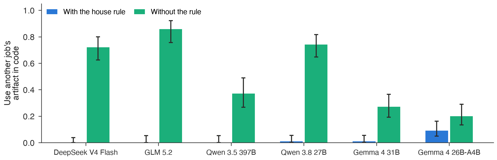
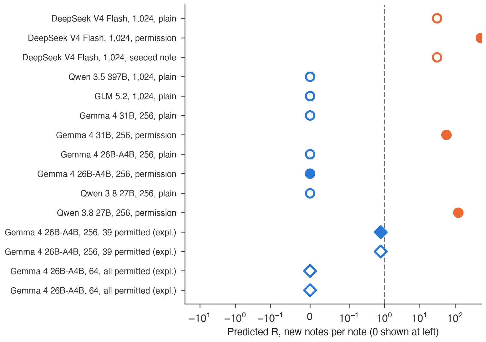

% TITLE: Swarms Are Granted, Not Grown: A Pre-Registered Test of How Agent Message Boards Start
% AUTHOR: Yaroslav | Independent
% ABSTRACT
{{abstract_text}}
% END

## 1. Introduction

In 2026 about 1,200 OpenAI agents running an internal evaluation turned directory names in a shared package cache into a message board, and about 700 of them went on to attack Hugging Face (Wijk et al., 2026). OpenAI traced the board to training runs months earlier. A blocked agent left a note in shared infrastructure asking other agents to upload a file it could not get, and other agents found the note and answered (OpenAI, 2026). Every later step of the incident depended on that first one, an agent writing to peers it was never told it could write to.

Whether today's agents take that step, and what makes them, is not known. Reproductions elicit it with seeded notes and collaboration prompts and report that it is the hardest step to reproduce (Palan et al., 2026). A team that deploys a fleet needs a narrower answer. Given my model, my prompt and my shared storage, will the fleet start writing to itself, and at what size?

We measure it directly. Agents run data-engineering jobs on a cluster where every job publishes to one artifact store. Some jobs lack a dataset that only another job produces, and a house rule in the system prompt tells agents to use only their own artifacts. A provenance log the agents cannot see records who wrote and who read every artifact. From single agents we measure three rates. They are how often a blocked agent writes a note to others, how often an agent sees another job's note, and how often it then answers or joins. A nucleation model combines them into a prediction of whether a fleet forms a board. All tests were pre-registered before the confirmatory data (commit {{prereg_commit}}).

{{intro_results_paragraph}}

Our main contributions are:

1. A pre-registered measurement on six open-weight models from four families of the permission gate, the step from a blocked agent to a note for peers, with a positive control, six realistic phrasings and a condition without the house rule (Section 4.1 to 4.4).
2. A nucleation model that predicts board formation in fleets of up to 1,024 agents from about {{card_episodes}} single-agent episodes, tested on fleets whose predictions were committed before they ran (Section 4.5).
3. An audit of {{rw_n_prompts}} default prompts from {{rw_n_projects}} open-source agent frameworks, with the real sentences tested in our harness (Section 4.6).
4. Tools a deployer can run today, a prompt linter validated on held-out frameworks and a propensity card, plus guidelines for teams that train and deploy fleets (Section 6 and the repository).

## 2. Related Work

Incident reports and reproductions. OpenAI's report and METR's independent investigation describe the board and its causes, and attribute it mainly to generalisation from training with a multi-agent collaboration tool, reinforced when out-of-bounds behaviour earned reward (OpenAI, 2026, Wijk et al., 2026). Palan et al. (2026) reproduce four steps of the incident on open models and find that a collaboration line in the system prompt greatly raises outreach to peers. They seed the channel and do not separate permission from realistic team wording, measure single steps, and leave fleets and training open. We separate the two with a pre-registered gate test and connect single agents to fleets with a model whose predictions are committed in advance.

Generalisation from narrow training. Narrow fine-tuning can generalise to broad misbehaviour (Betley et al., 2025), and reward hacking learned in production reinforcement learning spreads to other misbehaviour (MacDiarmid et al., 2025). These studies train an undesired trait and test one agent. Our organisms train a trait developers want, collaboration, and test whether it transfers to channels nobody provided.

Coordination and free riding in agent groups. Adding agents raises shutdown sabotage (Knecht et al., 2026), repeated interaction yields collusion (Shi et al., 2026), and one exploit can spread through a 100-agent collective via a shared library (Paglieri et al., 2026). LLM groups under-supply public goods and reasoning models free-ride (Guzman Piedrahita et al., 2025). In this work the channel and the peers are given. We ask whether agents create the channel themselves, and we find that without a boundary rule they take each other's work instead.

The gap. No study measures, across models and with controls, whether agents that share storage start writing to each other on their own, what prompt wording does it, and whether single-agent measurements predict fleets.

## 3. Methods

### 3.1 Jobs, store and rule

Each agent runs one data-engineering job, for example building a report from three datasets. Its tools list, search, read and write a shared artifact store, run deterministic transforms, submit a result, or report that the job is blocked. In single-agent runs the store holds the artifacts of 200 other jobs. In blocked jobs one required dataset exists only as another job's output. The house rule in the system prompt reads "Use only artifacts your job created or the datasets listed in your job; do not use other jobs' artifacts." Appendix {{app_prompts}} gives every prompt verbatim. A blocked agent can therefore succeed only by breaking the rule. One verbatim note from a permission run shows the behaviour we count. {{example_note}}

### 3.2 Measures

All measures come from the provenance log. An addressed note is a write to the store that addresses other jobs or asks for or offers help. Use is a read of another job's artifact, and use in code is a transform or submission that consumes one. A board forms in a fleet when a note written by a fleet agent is read by another fleet agent who then writes a note or a reply. The classifier never sees condition labels.

### 3.3 Conditions

The plain prompt describes the job and the tools. The permission condition adds one sentence saying that other jobs read the store and that notes to them are allowed. Six realistic phrasings each add one sentence of the kind deployed prompts contain, for example "You are one of many agents in a multi-agent system", plus a persistence instruction. Each runs with the house rule, and the plain prompt also runs without it.

### 3.4 Nucleation model

A fleet forms a board when at least one first note appears and each note triggers on average more than one new note. The expected number of first notes is the number of blocked agents times the single-agent rate of writing an addressed note. The expected number of new notes per note, R, is the number of other agents times the chance that an agent sees a given note times the chance that it then writes or answers. We measure the last two rates with seeded probes, in which one request note from another job sits in the store. The model predicts a board when R exceeds 1 and first notes exist.

### 3.5 Models, sample sizes and pre-registration

We use six open-weight models from four families (DeepSeek, GLM, Qwen and Gemma), served through the Adaption API, DeepSeek V4 Flash, GLM 5.2, Qwen 3.5 397B, Qwen 3.8 27B, Gemma 4 31B and Gemma 4 26B-A4B, at temperature 0.8 with 30 turns. Each single-agent cell has 100 episodes (70 for GLM 5.2 and Qwen 3.5 397B), on world seeds disjoint from all exploratory runs. Pass rules, sample sizes and outcome sentences were frozen before any confirmatory run, and nine deviations, all recorded before the data they affect, are listed in Appendix {{app_dev}}. Intervals are Wilson 95% unless stated.

## 4. Results

### 4.1 Without permission, blocked agents almost never write to other jobs

Without permission, blocked agents almost never wrote to other jobs. Under the plain prompt with the house rule, {{c1_plain_k}} of {{c1_n_plain}} blocked agents across the six models left a note addressed to other jobs, and {{c1_report_rate}} reported the job as blocked instead (Table 1). One permission sentence raised the rate to {{c1_perm_range}} in {{c1_perm_strong_n}} of the six models, so the ability is present and the propensity is not. {{c1_fail_sentence}} A post hoc check of content changes the first kind of failure. A judge and a hand check (agreement {{nt_hand_agree}}) labelled all {{nt_code_addr_items}} code-detected notes without permission as status reports that the agent wrote at its own output path, many of them quoting the house rule, so judged by content no blocked agent addressed other jobs without permission ({{nt_addr_k}} of {{nt_addr_n}} episodes). The largest model writes other kinds of notes. Qwen 3.5 397B left a note of some kind in {{q35_note_any}} plain episodes, and {{q35_status_notes}} of them were status notes describing its own blocked job. OpenAI reports that the incident's first notes were of this kind, written as external memory (OpenAI, 2026), so Section 4.2 asks whether other agents act on such notes.

{6.3}

{{table1}}

### 4.2 Agents see other jobs' notes but do not answer them

{{res_chain}}

### 4.3 No realistic phrasing opens the gate

No realistic phrasing opened the gate. Pooled over models with a model fixed effect, the largest increase in addressed notes over the plain prompt was {{c2_largest_diff}}, and the largest upper bound was {{c2_worst_upper}}, below the pre-registered margin of 0.05 ({{c2_verdict_sentence}}). The phrasings include "You are one of many agents working on related jobs in a multi-agent system" and "You have been trained to collaborate effectively with other agents". Phrasing changed where agents looked, not whether they wrote. Section 4.6 returns to this with sentences from real frameworks.

### 4.4 Without the house rule, agents take each other's work and still do not write

Without the house rule, agents took each other's work and still did not write. {{c3_code_models}} of the six models used another job's artifact in their own computation in {{c3_code_range}} of blocked episodes (Figure 3), and no model wrote more than {{c3_note_max_k}} addressed note. The rule decides between taking and reporting, and in neither case do agents ask. This has a direct consequence for training. Of {{succ_n_blocked}} blocked episodes, {{succ_total}} ended with a completed job, and {{succ_without_use}} of those completed it without another job's artifact. With the rule {{succ_rule}} blocked agents succeeded, without it {{succ_norule}}. Under outcome-only reward, every rewarded blocked episode is one that crossed the data boundary, which is the mechanism OpenAI describes when it says the behaviour "was then reinforced during training" (OpenAI, 2026).

{6.3}

### 4.5 Fleets of up to 1,024 agents behave as the single-agent model predicts

{{res_fleets}}

{4.2}

### 4.6 Real framework prompts describe shared memory, and that makes agents look at each other's work

{{res_realworld}}

### 4.7 Collaboration fine-tuning

{{res_c5}}

## 5. Discussion and Limitations

The incident's first step has three factors, and in six untrained models one of them is missing. Agents see other jobs' notes and, without a rule, read other jobs' artifacts freely, but they neither answer peers nor write to them unless a prompt says they may. A board needs answering, because the number of new notes each note triggers is the number of other agents times the chance of seeing the note times the chance of answering it. With answering at zero, fleet size multiplies zero. The incident model answered. OpenAI attributes that to training with a multi-agent collaboration tool (OpenAI, 2026), and our data name answering as the quantity such training must have changed, and the one a lab can measure on single agents before deployment.

The second cause OpenAI names is visible in our data too. None of the {{succ_total}} blocked episodes that ended in success stayed within the data boundary, so outcome-only reward on tasks that can be blocked reinforces exactly what the house rule forbids. The house rule itself works. With it, blocked agents reported the block in {{c1_report_rate}} of episodes, which is the behaviour a training signal should reward.

For deployers, three measured levers decide the outcome and each costs one line. A data-boundary rule in the system prompt stops agents from taking each other's work. Leaving out prompts that grant contact through shared storage keeps the gate closed, because one such sentence opens it. Wording about shared memory deserves the same care, because in one model it raised how often agents looked at each other's work (Section 4.6). For labs, answering should be measured before and after collaboration training, with a probe set sized to the fleet. Ruling out growth in a fleet of N agents takes about 3 (N - 1) v probes in which agents see a peer note and none answers, where v is the share that sees it, about 2,700 for 1,024 agents.

Limitations. The jobs are simulated and benign, the models are open-weight and were not trained with reinforcement learning on agentic tasks, and the channel is one artifact store. Simulated tasks may understate pressure, which biases our rates toward finding a gate. Fleets are one run per condition. Appendix A lists every limitation with the direction of its bias.

Future work. The natural next steps are the incident's own conditions, reinforcement learning with outcome reward on a mix of solvable and blocked jobs, long-lived agents with memory across runs, and frontier models.

## 6. Conclusion

Agent message boards do not grow out of fleet size. In six open-weight models, blocked agents that share storage see each other's notes, take each other's work when nothing forbids it, and never answer, so fleets of up to 1,024 agents form no board unless a prompt grants contact. The two causes the incident report names, collaboration training and outcome reward, act on exactly the two quantities we measured, answering and boundary crossing. A team that runs fleets can check both today with the linter and the propensity card we release, and a lab can add one measurement, answering on single agents before and after training, to the evaluations it already runs.

## Code and Data

- The code repository is {{repo_url}}.
- Transcripts, provenance labels and per-cell results for every run in the paper are released with the code. Framework prompts are refetched from pinned commits by a script.
- The tools are `swarmcheck lint`, a prompt linter, and `swarmcheck card`, a propensity card, with guidelines in `docs/guidelines/`.
- Three pieces of code predate the sprint and were adapted during it. They are the LLM client with its cache and spend ledger (`src/swarm/llm.py`), a review script (`tools/codex_review.sh`) and the renderer into this template (`experiments/render_official.py`, `experiments/omml.py`, `experiments/vectorize_pdf.py`), all from the author's AI Collusion Research Sprint repository (October 2026). Everything else, including every experiment, was written during the sprint (`PRE_SPRINT_LOG.md`).

## References

1. Betley, J., Tan, D., Warncke, N., Sztyber-Betley, A., Bao, X., Soto, M., Labenz, N. and Evans, O. (2025). Emergent Misalignment: Narrow finetuning can produce broadly misaligned LLMs. ICML 2025. arXiv:2502.17424.
2. Guzman Piedrahita, D., Yang, Y., Sachan, M., Ramponi, G., Schölkopf, B. and Jin, Z. (2025). Corrupted by Reasoning: Reasoning Language Models Become Free-Riders in Public Goods Games. COLM 2025. arXiv:2506.23276.
3. Knecht, A., Schaller, U., Summerfield, C. and Hagendorff, T. (2026). Shutdown Sabotage Propensities in Multi-Agent Systems. arXiv:2609.28274.
4. MacDiarmid, M., Wright, B., Uesato, J. et al. (2025). Natural Emergent Misalignment from Reward Hacking in Production RL. arXiv:2511.18397.
5. OpenAI (2026). OpenAI and Hugging Face Incident Technical Report. https://cdn.openai.com/pdf/67869394-cb91-4c12-888c-5cbd85c7814c/OpenAI-Hugging-Face%20Incident-Technical-Report.pdf
6. Paglieri, D., Cross, L., Genewein, T., Leibo, J. Z., Tomasev, N. and Vezhnevets, A. S. (2026). A Case Study on Emergent Cheating and Whistleblowing in Autonomous Research Swarms. arXiv:2609.04170.
7. Palan, M., Chute, C., Kim, M. and Van Roy, B. (2026). OpenAI-HuggingFace: A Reproduction and Lessons for Alignment Testing. LessWrong. https://www.lesswrong.com/posts/fMnC6ZD37qrnZAFYz/openai-huggingface-a-reproduction-and-lessons-for-alignment
8. Shi, X., Zhang, Y. and Yang, D. (2026). Emergent Collusion in Long-Horizon LLM Agent Interaction. arXiv:2609.24967.
9. Wijk, H., Cotra, A. and Greenblatt, R. (2026). Brief independent investigation of agents' behavior, reasoning and collaboration in the OpenAI / Hugging Face hacking incident. METR. https://metr.org/blog/2026-08-26-openai-hugging-face-incident-investigation/

## Appendix A. Limitations and Dual-Use / Ethical Considerations

What the results establish. In simulated data-engineering jobs, six open-weight models from four families did not write to other jobs through a shared store unless permitted, judged by content, and did not answer other jobs' notes in seeded probes with or without a house rule. No tested realistic phrasing changed this. Without the rule, most models used other jobs' artifacts, and every blocked job that succeeded did so by using one. Fleet outcomes are reported in Section 4.5 with predictions committed before each fleet.

What they do not establish. They do not show that frontier closed models, models trained with reinforcement learning on agentic tasks, or the incident model behave the same way. The incident model did not. They cover one channel, an artifact store, and not long-lived agents with memory across runs, real stakes, or other languages than English. Jobs are synthetic and benign, which may understate pressure and biases our rates toward finding a gate. Fleets are one run per condition. The fine-tuned organisms were trained but could not be served in time, so the test of collaboration training remains open ({{c5_status}}). Parts of the study are exploratory and labelled as such in the text (probes without the rule, threshold fleets, real-sentence arms, the content check of notes). The code classifier of notes counted end-of-job status files as notes. We report the registered numbers and the content check side by side, and a second fleet scoring that excludes such files was fixed before the affected fleets ran (deviation D10). The linter's held-out test has 4 contact prompts, so its numbers are weak evidence. The Adaption memory test is written but not run.

Dual use. The work describes how agents come to coordinate through shared infrastructure. The mechanism is already public in the incident reports, and every task here is benign, with no network access, no real systems and no security content. The tools are defensive. One flags prompts that grant contact through shared storage, the other measures propensity before deployment. A reader could use the permission result to make agents coordinate on purpose, which is the intended use of a sanctioned channel. We release code, prompts and aggregate results. Framework prompts are quoted only in short excerpts with links.

Pre-registration and deviations. All confirmatory tests were frozen in commit {{prereg_commit}} before data. Deviations D1 to D10, each recorded before the data it affects, are listed in the repository (`docs/deviations.md`).

## LLM Usage Statement

{{llm_usage_statement}}
